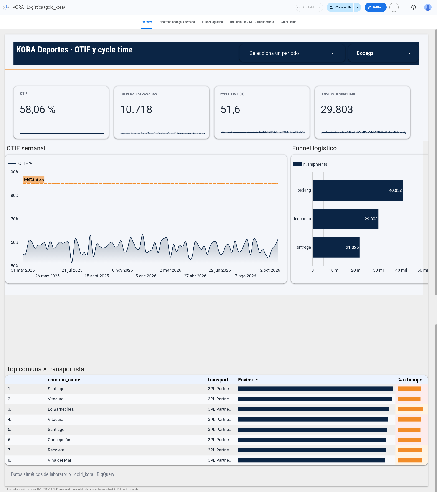

# Paso 11 — Overview pulido (Looker Studio)

**Proyecto:** KORA Deportes · Logística (WMS + last mile)  
**Informe público:** [Data Studio viewer](https://datastudio.google.com/reporting/172aa667-fb63-4c36-84d4-4585c8ad89ba)  
**Prerrequisito:** Paso 9 (vistas gold + informe publicado) + [`looker/STYLE_GUIDE.md`](../looker/STYLE_GUIDE.md)  
**Alcance:** polish de la página Overview en el informe público (bot Dash / Data Studio). **Sin cambios SQL** ni rebuild gold.  
**Capturas:** [`looker/screenshots/overview/`](../looker/screenshots/overview/)

> **Nota de captura:** `overview_final.png` está **pegada** a partir de dos capturas. La franja gris entre el funnel y la tabla es un **artefacto del stitch**, no forma parte del informe publicado.

---

## Meta

Documentar el pulido visual y de métricas del Overview para defensa de portafolio / entrevista: qué cambió, por qué (alineado a la style guide), cómo se hizo en Data Studio y cómo se verificó con números reales (seed 42).

---

## Qué cambió

| ID | Cambio | Antes → después |
|---|---|---|
| **(a)** | OTIF semanal | Dimensión de fecha **diaria** → **Año y semana ISO**. Métrica intacta. Línea Meta 85% intacta. |
| **(b)** | Sparklines KPI | Ya renderizaban en los 4 scorecards; **sin cambios** en este paso. |
| **(c)** | Deltas vs período anterior | Activados en OTIF, Entregas atrasadas, Cycle time y Envíos despachados (colores semáforo según dirección “buena”). |
| **(d)** | Semáforo tabla | Formato condicional en **fila entera** → **solo columna «% a tiempo»**. |
| **(e)** | Tipografía KPI | Valor ~30px; nombre de métrica del scorecard oculto y reemplazado por cuadros de texto uppercase (Roboto 11px bold `#6B7280`). |
| **(f)** | Orden funnel | Orden por `n_shipments` desc → por **`stage_code` ascendente**. Filtro `funnel_kind = shipment_e2e` intacto. |

---

## Por qué (vs `looker/STYLE_GUIDE.md`)

Cada cambio cierra un ítem del checklist de la style guide (§3):

| Cambio | Token / regla STYLE_GUIDE | Motivo de negocio |
|---|---|---|
| **(a)** Semanal | §3(a) granularidad Semana ISO / `DATETIME_TRUNC(fecha, WEEK)` | Serie diaria es ruido; semana ISO deja ver tendencia OTIF vs Meta 85% sin re-agregar mal el ratio. |
| **(b)** Sparklines | §3(b) sparkline semanal en scorecards | Ya cumplido; no tocar. |
| **(c)** Deltas | §3(c) comparación con período anterior; colores verde `#2BB673` / rojo `#E5484D` | El ejecutivo necesita “¿mejoró o empeoró?”; OTIF sube = verde; atrasadas y cycle time **invertidos** (bajar = bueno). |
| **(d)** Semáforo celda | §3(d) formato condicional **solo** en «% a tiempo»; umbrales `<0,50` / `0,50–0,55` / `>0,55` | Pintar la fila entera ensucia barras y conteos; el semáforo debe leerse en el % a tiempo. |
| **(e)** Tipografía KPI | Tokens label 11px uppercase `#6B7280`; valor 28–32px | El scorecard de Looker usa **un solo tamaño** para etiqueta y valor → ocultar label nativo + cuadro de texto. |
| **(f)** Funnel `stage_code` | §3(f) ordenar por `stage_code` asc, no por métrica | Orden por volumen rompe picking → despacho → entrega. |

Fórmulas canónicas (sin cambio de semántica vs Paso 9):

- OTIF % = `SUM(n_otif)/SUM(n_intentadas_cerradas)` — agregación Automática (**nunca** `AVG(otif_pct)`).
- Envíos despachados = `COUNT_DISTINCT(shipment_id)` sobre **`v_entregas_drill`** (no `v_cycle_time`).

---

## Cómo se hizo (Data Studio, sin SQL)

Trabajo en el informe publicado (modo edición), página Overview:

1. **(a)** Gráfico OTIF → dimensión de período → **Año y semana ISO**; métrica y línea Meta 85% sin tocar.
2. **(c)** En cada scorecard con delta: comparación vs período anterior (% de cambio). Dimensión de período:
   - OTIF / atrasadas: `fecha_id` de `v_otif_diario`.
   - Cycle time: dimensión de fecha de `v_cycle_time`.
   - Envíos despachados: ver lección abajo (`fecha` de `v_entregas_drill`).
3. **(d)** Tabla comuna × transportista → formato condicional solo en «% a tiempo» con umbrales de la style guide.
4. **(e)** Scorecards → valor 30px; ocultar nombre de métrica; cuadros de texto uppercase encima.
5. **(f)** Funnel → ordenar por `stage_code` ascendente; filtro `funnel_kind = shipment_e2e`.

**Sin cambios** en vistas gold, `build_gold.py` ni DDL.

---

## Lección defendible en entrevista — dimensión de período en «Envíos despachados»

**Síntoma:** el scorecard «Envíos despachados» **no respondía** al control de período (el valor quedaba fijo al total histórico).

**Causa:** el scorecard **no tenía dimensión de período** cableada; sin ella Looker no puede comparar ni filtrar por el rango del control.

**Fix (solo canvas):**

1. Usar dimensión **`fecha`** de `v_entregas_drill` — misma familia de fecha que alimenta OTIF vía `fecha_id` (día de entrega/intento), **no** `ship_fecha_id` (día de despacho).
2. Métrica `COUNT_DISTINCT(shipment_id)` por el fan-out shipment×SKU del drill.
3. Activar comparación vs período anterior (verde sube / rojo baja).

**Por qué no `ship_fecha_id`:** el filtro de período del Overview alinea OTIF / late / cycle al día de entrega (o ciclo cerrado). Mezclar “envíos por ship_date” con “OTIF por delivery date” en el mismo rango engaña al lector.

**Respuesta corta:** *«El KPI no filtraba porque el scorecard no tenía dimensión de período. Cableé `fecha` de `v_entregas_drill` (mismo eje que OTIF), con `COUNT_DISTINCT(shipment_id)` por el fan-out, sin tocar SQL.»*

---

## Cómo se verificó

1. Viewer **share-as-reader**, sin filtros cruzados residuales (Restablecer si hace falta).
2. Lectura de scorecards, funnel y top de tabla vs canónicos seed 42.
3. Segundo pase con control de período **15 oct – 11 nov 2026** para validar deltas.
4. Vuelta a sin filtro → mismos totales del baseline.

### Valores verificados — sin filtros

| Métrica | Valor |
|---|---|
| OTIF | **58,06%** |
| Entregas atrasadas | **10.718** |
| Cycle time | **51,6 h** |
| Envíos despachados | **29.803** |
| Funnel `shipment_e2e` | **40.823 / 29.803 / 21.325** |
| Top tabla Santiago / 3PL Partner 10 | **283** envíos · **49,82%** a tiempo |

### Valores verificados — período 15 oct – 11 nov 2026

| Métrica | Valor | Δ vs período anterior |
|---|---|---|
| OTIF | **57,46%** | **+2,5%** |
| Entregas atrasadas | **345** | **−35,2%** |
| Cycle time | **56,03 h** | **+9,3%** |
| Envíos despachados | **940** | **−33,8%** |

Sin filtro vuelve a **58,06% / 10.718 / 51,6 / 29.803**.

---

## Capturas

| Archivo | Contenido |
|---|---|
| [`overview_final.png`](../looker/screenshots/overview/overview_final.png) | Overview completo, modo lector, sin filtros (**stitch** de dos capturas; franja gris funnel↔tabla = artefacto) |
| [`overview_baseline.png`](../looker/screenshots/overview/overview_baseline.png) | Antes del pulido |
| [`overview_a_semanal.png`](../looker/screenshots/overview/overview_a_semanal.png) | OTIF semanal |
| [`overview_c_deltas.png`](../looker/screenshots/overview/overview_c_deltas.png) | 4 KPI con deltas (15 oct – 11 nov 2026) |
| [`overview_d_semaforo.png`](../looker/screenshots/overview/overview_d_semaforo.png) | Tabla con semáforo solo en «% a tiempo» |
| [`overview_e_kpis.png`](../looker/screenshots/overview/overview_e_kpis.png) | Fila KPI (tipografía) |

---

## Criterios de aceptación

- [x] Checklist STYLE_GUIDE (a)–(f) aplicado o confirmado en Overview
- [x] Valores sin filtro = canónicos Paso 9 / style guide
- [x] Deltas verificados en rango 15 oct – 11 nov 2026
- [x] Lección dimensión de período documentada (sin SQL)
- [x] Capturas en `looker/screenshots/overview/` + nota de stitch en `overview_final.png`

---

## Referencias

- [`looker/STYLE_GUIDE.md`](../looker/STYLE_GUIDE.md) — tokens y checklist
- [`looker/README.md`](../looker/README.md) — conexión BQ + números Paso 9
- [`docs/paso-09-looker.md`](paso-09-looker.md) — vistas gold y trampas de métrica
- Fuente operativa del bot Dash: store `media/paso-11-overview/RESUMEN_overview.md`
