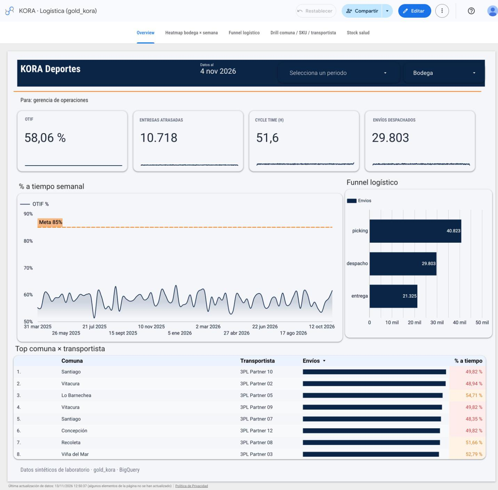

# Looker Studio — KORA Deportes (Paso 9)

Guía exacta para conectar el dashboard MVP al datamart gold.  
**Proyecto BQ:** `kora-sports` · **Dataset:** `gold_kora` · **Región:** `southamerica-west1`

> Auth en la laptop de Julio (ADC). Este repo **no** guarda credenciales GCP ni publica el informe por el agente.

**Estilo / polish del informe:** [`STYLE_GUIDE.md`](STYLE_GUIDE.md) — tokens, estado actual Overview, checklist Data Studio y mockups en [`mockup/`](mockup/) (referencia visual; no valores en vivo).  
**Overview pulido (Paso 11):** [`docs/paso-11-overview-pulido.md`](../docs/paso-11-overview-pulido.md) — semanal, deltas, semáforo celda, tipografía KPI, funnel por `stage_code`; capturas en [`screenshots/overview/`](screenshots/overview/).

---

## Informe publicado

| Campo | Valor |
|---|---|
| **Viewer link (share-as-reader)** | [Abrir dashboard KORA](https://datastudio.google.com/reporting/172aa667-fb63-4c36-84d4-4585c8ad89ba) |
| **Acceso** | Cualquiera con el link puede ver. Las 6 fuentes usan **credenciales del propietario**: el lector no necesita acceso a BigQuery (verificado abriendo el informe sin sesión, 2026-11-12) |
| **Screenshot overview** | [`looker/screenshots/01-overview.png`](screenshots/01-overview.png) |
| **Screenshot heatmap** | [`looker/screenshots/02-heatmap.png`](screenshots/02-heatmap.png) |
| **Screenshot funnel** | [`looker/screenshots/03-funnel.png`](screenshots/03-funnel.png) |
| **Screenshot drill** | [`looker/screenshots/04-drill.png`](screenshots/04-drill.png) |
| **Screenshot stock salud** | [`looker/screenshots/05-stock.png`](screenshots/05-stock.png) |

Estructura común (cierre 2026-11-13): header navy a nivel de informe con «KORA Deportes», fecha de corte **«Datos al»** y controles **Periodo** y **Bodega**; filete naranja; cada página con su título y una línea **«Para: …»** que dice a qué audiencia sirve. El filtrado cruzado (en la UI en español: **Multifiltro**) está apagado en todos los gráficos salvo en el Drill, donde un clic en una barra filtra la tabla.

### Capturas (Data Studio · modo Ver · 2026-11-13)

Cada captura une 2–3 tomas de la misma página (el informe es más alto que la ventana).




Capturas del pulido de Overview (Paso 11, 2026-11-11), como historial: [`screenshots/overview/overview_final.png`](screenshots/overview/overview_final.png) y el resto de [`screenshots/overview/`](screenshots/overview/).

---

## Valores observados (Data Studio · modo Ver · 2026-11-13)

Números leídos del informe publicado (datos sintéticos seed 42). **No inventados.** Sin filtros, salvo donde se indica.

| Página / métrica | Valor observado | Cómo se calcula en Looker |
|---|---|---|
| Overview · OTIF (parte On Time) | **58,06%** | `SUM(n_otif)/SUM(n_intentadas_cerradas)` — **nunca** `AVG(otif_pct)`. Es la parte *On Time*: entregadas a tiempo / entregas cerradas. El *In Full* (`n_otif_con_in_full`) se expone aparte porque depende de una asunción del lab (el export TM no trae `qty_ordered`) |
| Overview · Entregas atrasadas | **10.718** | `SUM(n_late)` sobre `v_otif_diario`. 10.718 / 25.619 cerradas = 41,8%, complemento del 58,06% (consistencia entre páginas) |
| Overview · Cycle time pick→entrega | **51,6 h** | `AVG(cycle_hours_pick_to_ata)` sobre `v_cycle_time` (grano envío; población 25.609 = cerradas con ATA y picking) |
| Overview · Envíos despachados | **29.803** | `COUNT_DISTINCT(shipment_id)` sobre `v_entregas_drill` |
| Overview · Datos al | **4 nov 2026** | `MAX(fecha)` sobre `v_otif_diario` (entregas con lag de 0–4 días después del 31-oct) |
| Heatmap · % atrasadas | total por bodega **39,94%–48,14%** (31 ago–26 oct 2026) | Campo `% atrasadas` = `SUM(n_late)/SUM(n_cerradas)` en la fuente. Período predeterminado fijo 31-ago → 1-nov-2026 en la tabla y en el combinado |
| Heatmap · Pick lead (min) | aprox. 230–250 min por bodega, parejo (lectura del gráfico) | `SUM(avg_pick_lead_minutes * n_con_pick)/SUM(n_con_pick)`: promedio ponderado, no promedio de promedios |
| Funnel `shipment_e2e` | **40.823 / 29.803 / 21.325** | `n_shipments` por `stage_label`. Conversiones **73,0%** y **71,6%** |
| Funnel · estado final | **14.893** entregado · **6.432** tarde · **4.294** fallido · **4.184** en tránsito (suma 29.803) | `funnel_kind = status`. El funnel es global: la vista no trae fecha ni bodega |
| Drill · % a tiempo por transportista | **48,56%** (3PL Partner 10) a **51,03%** (3PL Partner 03) | `COUNT_DISTINCT(CASE WHEN on_time THEN shipment_id END)/COUNT_DISTINCT(shipment_id)`. Base: **todos** los envíos, incluidos los en tránsito; por eso no es el OTIF |
| Drill · primera fila | Santiago / 3PL Partner 10 = **283** envíos · **49,82%** | Igual en Overview y Drill |
| Drill · envíos por categoría | suman **29.803** | Textil 8.710 · Equipo 7.790 · Calzado 7.320 · Accesorio 5.983 |
| Stock · Quiebre | **0,30%** de días-SKU | porcentaje de días-SKU con `is_stockout` sobre `v_stock_salud` |
| Stock · Sobrestock | **70,94%** de días-SKU | días-SKU con `is_overstock` (DOH > 45, heurística lab) |
| Stock · DOH ponderado | **507,99** días | `SUM(usable_qty)/SUM(avg_out_7d)`. Reemplaza el `AVG(doh_7d)` = 722,67 de la versión anterior |

**Lectura de negocio:** ni la bodega (picking y % atraso parejos entre las 8) ni un transportista puntual (los 12 en una banda de 2,5 puntos, casi dentro del margen de error con ~2.500 envíos cada uno) explican el atraso. Un atraso parejo en toda la red apunta a la promesa (ETA). En el lab, los datos sintéticos no traen una diferencia sembrada por bodega ni por transportista.

**Heurísticas de Stock:** el stock sintético está sobredimensionado frente a la demanda; DOH y sobrestock son heurísticas del lab y el umbral de 45 días se calibraría con supply en un caso real.

---

## Prerrequisito datos

```bash
make run          # regenera CSV → bronze → silver → gold (vistas 08–13)
# o solo gold si silver ya está:
python scripts/build_gold.py --dry-run
python scripts/build_gold.py
```

Post-check Paso 9: vistas existen, `rows > 0`, coherencia heatmap/funnel/drill.

---

## 1) Crear data source BigQuery

1. Abrir [Looker Studio](https://lookerstudio.google.com/) → **Create** → **Data source**.
2. Conector **BigQuery**.
3. Proyecto: **`kora-sports`**.
4. Dataset: **`gold_kora`**.
5. Añadir **una data source por vista** (recomendado; evita joins caros en el canvas):

| Data source (nombre sugerido) | Tabla/vista BQ | Uso dashboard |
|---|---|---|
| `KORA · OTIF diario` | `v_otif_diario` | Overview OTIF % / late |
| `KORA · Cycle time` | `v_cycle_time` | Overview cycle E2E |
| `KORA · Stock salud` | `v_stock_salud` | Página Stock salud |
| `KORA · Heatmap bodega×semana` | `v_heatmap_bodega_semana` | Heatmap |
| `KORA · Funnel logístico` | `v_funnel_logistico` | Funnel |
| `KORA · Entregas drill` | `v_entregas_drill` | Drill comuna/SKU/carrier |

6. Tipo de credencial: **credenciales del propietario** (Owner's). Con *Viewer's credentials* el lector necesitaría acceso a BigQuery en `kora-sports` y vería los gráficos con error.
7. **Connect** → revisar campos (tipos DATE/BOOL/NUMERIC).

**Regla:** Looker **solo** lee `gold_kora`. Nunca `bronze_kora` / `silver_kora`.

---

## 2) Informe — páginas MVP (§10 levantamiento)

Crear informe en blanco → añadir las data sources de arriba.

### Página A — Overview (OTIF + cycle)

| Chart | Data source | Campos / filtro |
|---|---|---|
| Scorecard OTIF % | `v_otif_diario` | **Obligatorio:** `SUM(n_otif)/SUM(n_intentadas_cerradas)` — no `AVG(otif_pct)` |
| Scorecard late | `v_otif_diario` | `SUM(n_late)` |
| Scorecard cycle h | `v_cycle_time` | `AVG(cycle_hours_pick_to_ata)` |
| Time series OTIF | `v_otif_diario` | Dimensión `fecha`; misma fórmula OTIF |
| Filtros | — | `bodega_id`, rango `fecha` / semana |

### Página B — Heatmap bodega × semana

| Chart | Data source | Setup |
|---|---|---|
| Tabla dinámica (heatmap) | `v_heatmap_bodega_semana` | Filas: **Bodega** (`bodega_name`); columnas: **Semana** (`semana_inicio`); métrica: `% atrasadas` = `SUM(n_late)/SUM(n_cerradas)` (tipo Porcentaje, agregación AUT). Mapa de calor rojo `#E5484D`, filas ordenadas por `% atrasadas` desc, suma total activada. Período predeterminado fijo 31-ago → 1-nov-2026 |
| Gráfico combinado | `v_heatmap_bodega_semana` | Dimensión Bodega. Serie 1: `Pick lead (min)` = `SUM(avg_pick_lead_minutes * n_con_pick)/SUM(n_con_pick)`, barras navy, **eje izquierdo**. Serie 2: `% atrasadas`, línea naranja, **eje derecho**. Mismo período fijo |

> Las dos series necesitan su propio eje: en un eje compartido, el % (≈0,4) queda pegado al cero en la escala de minutos.

### Página C — Funnel picking → despacho → entrega

| Chart | Data source | Setup |
|---|---|---|
| Bar / funnel | `v_funnel_logistico` | **Filtro obligatorio:** `funnel_kind = shipment_e2e` |
| Dimensión | | `stage_label` (orden por `stage_code`) |
| Métrica | | `n_shipments` |

Alternativa volume (no conversión E2E): mismo chart con `funnel_kind ∈ {movement_type, status}` — ver gaps en `docs/paso-09-looker.md`.

### Página D — Drill comuna / SKU / transportista

| Chart | Data source | Dimensiones |
|---|---|---|
| Table / bar | `v_entregas_drill` | `comuna_name`, `sku_id`/`category`, `transportista_name` |
| Métricas | | `COUNT(DISTINCT shipment_id)`; % a tiempo con `COUNT_DISTINCT(CASE WHEN on_time THEN shipment_id END)/COUNT_DISTINCT(shipment_id)`; `SUM(qty_delivered)` |

> El bridge OUT WMS expande a grano **shipment×SKU**. `AVG(on_time)` o `AVG` de un BOOL distorsiona el % a tiempo.

### Página E — Stock salud

Fuente: `v_stock_salud`. Heurística de laboratorio — **no** es SLA stakeholder.

| Chart / scorecard | Campos |
|---|---|
| Quiebre (% días-SKU) | porcentaje de días-SKU con `is_stockout` |
| Sobrestock (% días-SKU) | porcentaje de días-SKU con `is_overstock` (DOH > 45) |
| DOH ponderado (días) | `SUM(usable_qty)/SUM(avg_out_7d)` — no `AVG(doh_7d)` |
| Tabla por bodega | las tres métricas, ordenada por Quiebre desc |

El DOH alto (~508 días) es artefacto del sintético (stock sobredimensionado frente a la demanda); en un caso real el umbral se calibraría con supply.

---

## 3) Publicar / compartir (manual)

1. **Share** → añadir viewers (cuenta Google) o link share-as-reader.
2. **File → Embed report** / link de viewer → URL real del informe.
3. Capturas en `looker/screenshots/` (este repo incluye las del cierre del 2026-11-13).

Viewer actual: https://datastudio.google.com/reporting/172aa667-fb63-4c36-84d4-4585c8ad89ba

---

## Lecciones de construcción

Trampas de métricas vistas al cablear el informe (útiles en entrevista):

1. **Promediar ratios de grano fino** — `AVG(otif_pct)` sobre filas diarias/bodega entrega ~**0,58%** (o un ratio sin ponderar). El OTIF correcto es **ponderado**: `SUM(n_otif)/SUM(n_intentadas_cerradas)` → **58,06%**. Misma columna, semántica distinta.
2. **Booleanos no se promedian** — `AVG(on_time)` en drill (grano shipment×SKU) no es % a tiempo. Usar `COUNT_DISTINCT` condicional / total de `shipment_id`.
3. **Overrides de métrica a nivel chart** — Looker deja redefinir la agregación por gráfico; un scorecard “AVG” heredado del data source puede contradecir el campo calculado del informe. Revisar cada chart.
4. **Cross-filters accidentales** — un filtro de página o un click en heatmap/funnel puede cruzar data sources y vaciar scorecards. Preferir filtros explícitos por control y desactivar “Filter interactions” donde no aporten. En la UI en español el interruptor se llama **Multifiltro** (sección *Gráficos interactivos*).
5. **Promedio de promedios** — `v_heatmap_bodega_semana` guarda `avg_pick_lead_minutes` por semana. Promediarlo de nuevo pesa igual una semana con 5 envíos que una con 500. Se pondera por `n_con_pick`.
6. **DOH promediado** — `AVG(doh_7d)` daba **722,67**: los SKU de baja rotación tienen DOH enorme y arrastran el promedio. El DOH ponderado (`SUM(usable_qty)/SUM(avg_out_7d)`) da **507,99**.
7. **Nombre honesto del KPI** — el 58,06% es la parte *On Time* del OTIF; el *In Full* se calcula aparte. En la entrevista se dice de entrada.
8. **Poblaciones distintas** — el % a tiempo del Drill (~50%) cuenta envíos en tránsito; el OTIF (58,06%) solo entregas cerradas. Cada gráfico dice su base en el subtítulo.
9. **Filtros pegados en la sesión del editor** — un clic con filtrado cruzado deja una selección guardada en la sesión de quien edita (barras grises, tarjetas con valores raros). No afecta a los lectores: verificar siempre en modo **Ver**, sin sesión, y usar **Restablecer**.
10. **Credenciales de la fuente** — con *Viewer's credentials* un lector sin acceso a BigQuery ve errores. Se usan las del propietario.

---

## Mapa rápido vista → pregunta de negocio

| Vista | Pregunta (§3–§5 / §10) |
|---|---|
| `v_otif_diario` | OTIF % por día / bodega / carrier / comuna |
| `v_cycle_time` | Cycle pick→ATA (E2E) |
| `v_stock_salud` | Stockout / DOH / overstock demo |
| `v_heatmap_bodega_semana` | ¿Dónde (bodega×semana) sube late o pick lead? |
| `v_funnel_logistico` | Conversión picking→despacho→entrega (derivada) |
| `v_entregas_drill` | Corte por comuna, SKU, transportista |

Detalle de gaps de schema y asunciones: [`docs/paso-09-looker.md`](../docs/paso-09-looker.md) — ver sección **Decisiones y cómo defenderlas**.
