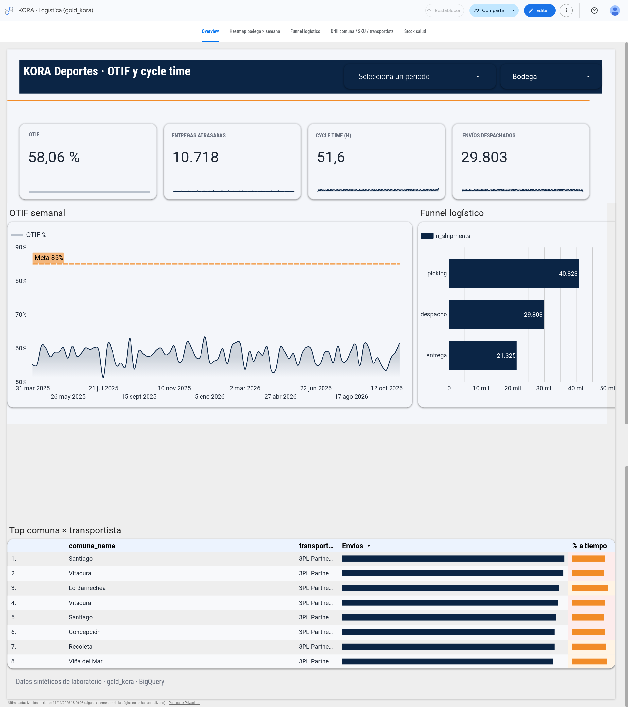
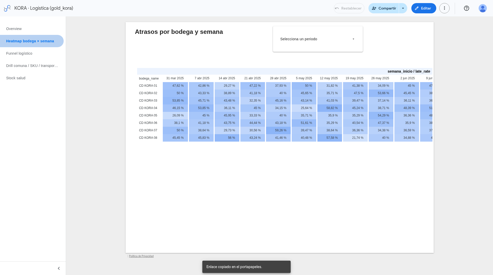
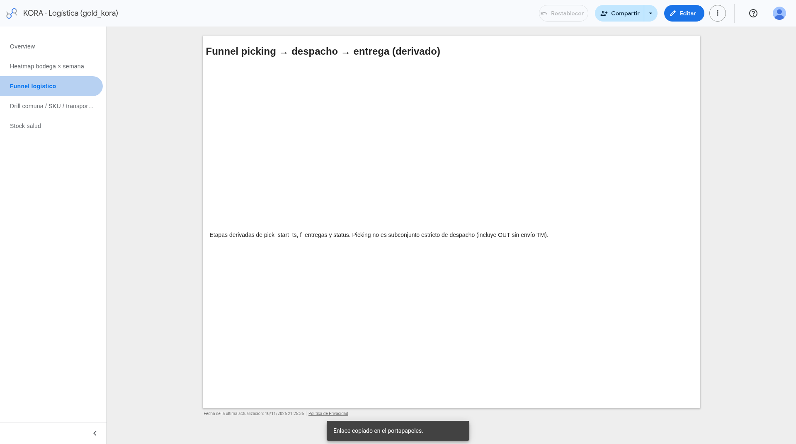
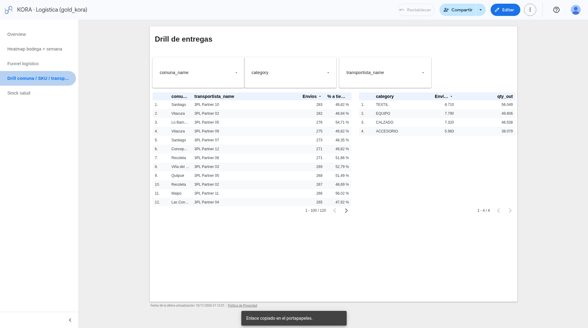
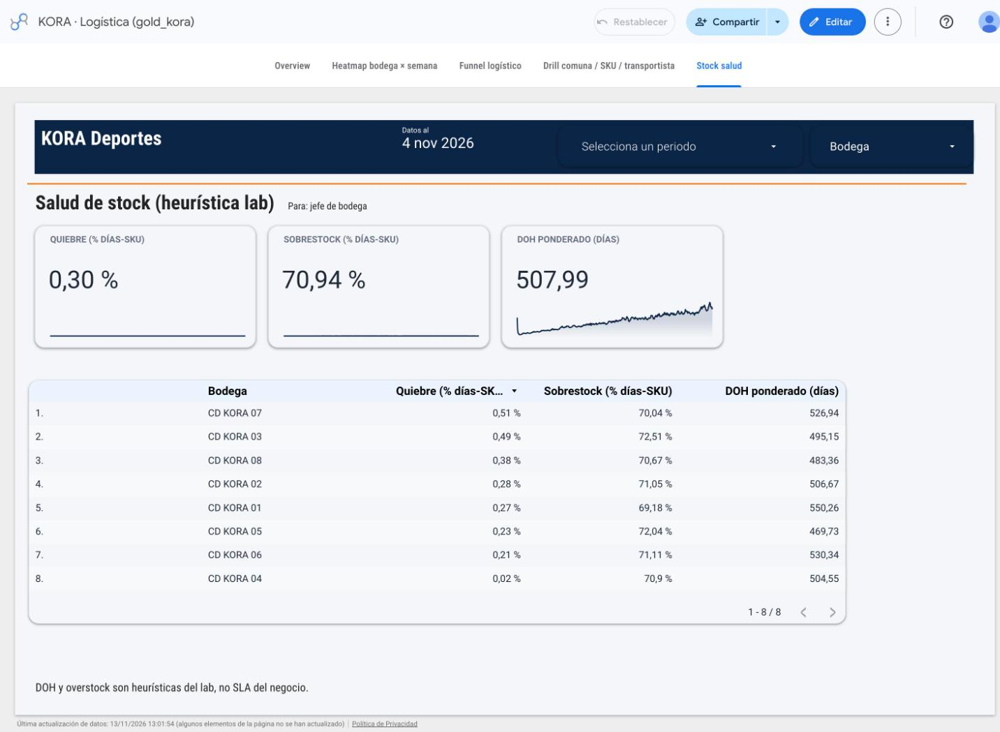

# Looker Studio — KORA Deportes (Paso 9)

Guía exacta para conectar el dashboard MVP al datamart gold.  
**Proyecto BQ:** `kora-sports` · **Dataset:** `gold_kora` · **Región:** `southamerica-west1`

> Auth en la laptop de Julio (ADC). Este repo **no** guarda credenciales GCP ni publica el informe por el agente.

**Estilo / polish del informe:** [`STYLE_GUIDE.md`](STYLE_GUIDE.md) — tokens, estado actual Overview, checklist Data Studio y mockups en [`mockup/`](mockup/) (referencia visual; no valores en vivo).  
**Overview pulido (Paso 11):** [`docs/paso-11-overview-pulido.md`](../docs/paso-11-overview-pulido.md) — semanal, deltas, semáforo celda, tipografía KPI, funnel por `stage_code`; capturas en [`screenshots/overview/`](screenshots/overview/).

---

## Informe publicado

| Campo | Valor |
|---|---|
| **Viewer link (share-as-reader)** | [Abrir dashboard KORA](https://datastudio.google.com/reporting/172aa667-fb63-4c36-84d4-4585c8ad89ba) |
| **Screenshot overview (pulido)** | [`looker/screenshots/overview/overview_final.png`](screenshots/overview/overview_final.png) |
| **Screenshot overview (Paso 9)** | [`looker/screenshots/01-overview.png`](screenshots/01-overview.png) |
| **Screenshot heatmap** | [`looker/screenshots/02-heatmap.png`](screenshots/02-heatmap.png) |
| **Screenshot funnel** | [`looker/screenshots/03-funnel.png`](screenshots/03-funnel.png) |
| **Screenshot drill** | [`looker/screenshots/04-drill.png`](screenshots/04-drill.png) |
| **Screenshot stock salud** | [`looker/screenshots/05-stock.png`](screenshots/05-stock.png) |

### Capturas (Data Studio · Overview pulido 2026-11-11)



> `overview_final.png` es un stitch de dos capturas; la franja gris entre funnel y tabla es artefacto del pegado, no del informe. Detalle del pulido: [`docs/paso-11-overview-pulido.md`](../docs/paso-11-overview-pulido.md).

### Capturas (Data Studio · cierre Paso 9 · 2026-11-10)









---

## Valores observados (Data Studio · 2026-11-10)

Números leídos del informe publicado (datos sintéticos seed 42). **No inventados.**

| Página / métrica | Valor observado | Cómo se calculó en Looker |
|---|---|---|
| OTIF % | **58,06%** | Campo calculado `SUM(n_otif)/SUM(n_intentadas_cerradas)` — **nunca** `AVG(otif_pct)` |
| Entregas atrasadas | **10.718** | `SUM(n_late)` sobre `v_otif_diario` |
| Cycle time pick→entrega | **51,6 h** | `AVG(cycle_hours_pick_to_ata)` sobre `v_cycle_time` |
| Funnel `shipment_e2e` | **40.823 / 29.803 / 21.325** | `n_shipments` por `stage_label` (picking → despacho → entrega) |
| Drill % a tiempo | top Santiago / 3PL Partner 10 = **49,82%** | `COUNT_DISTINCT(CASE WHEN on_time THEN shipment_id END)/COUNT_DISTINCT(shipment_id)` — el grano shipment×SKU no permite `AVG(on_time)` |
| Envíos por categoría | suman **29.803** | coherente con stage despacho del funnel |
| Stockouts | **627** | `COUNT` / filtro `is_stockout` en `v_stock_salud` |
| DOH 7d promedio | **722,67** | `AVG(doh_7d)` — artefacto de datos sintéticos (stock alto vs demanda); en prod habría que calibrar |
| Overstock | **147.867** filas | heurística lab `is_overstock` (no SLA stakeholder) |

---

## Prerrequisito datos

```bash
make run          # regenera CSV → bronze → silver → gold (vistas 08–13)
# o solo gold si silver ya está:
python scripts/build_gold.py --dry-run
python scripts/build_gold.py
```

Post-check Paso 9: vistas existen, `rows > 0`, coherencia heatmap/funnel/drill.

---

## 1) Crear data source BigQuery

1. Abrir [Looker Studio](https://lookerstudio.google.com/) → **Create** → **Data source**.
2. Conector **BigQuery**.
3. Proyecto: **`kora-sports`**.
4. Dataset: **`gold_kora`**.
5. Añadir **una data source por vista** (recomendado; evita joins caros en el canvas):

| Data source (nombre sugerido) | Tabla/vista BQ | Uso dashboard |
|---|---|---|
| `KORA · OTIF diario` | `v_otif_diario` | Overview OTIF % / late |
| `KORA · Cycle time` | `v_cycle_time` | Overview cycle E2E |
| `KORA · Stock salud` | `v_stock_salud` | Página Stock salud |
| `KORA · Heatmap bodega×semana` | `v_heatmap_bodega_semana` | Heatmap |
| `KORA · Funnel logístico` | `v_funnel_logistico` | Funnel |
| `KORA · Entregas drill` | `v_entregas_drill` | Drill comuna/SKU/carrier |

6. Tipo de credencial: **Viewer's credentials** (demo) o Owner's si compartes fixed.
7. **Connect** → revisar campos (tipos DATE/BOOL/NUMERIC).

**Regla:** Looker **solo** lee `gold_kora`. Nunca `bronze_kora` / `silver_kora`.

---

## 2) Informe — páginas MVP (§10 levantamiento)

Crear informe en blanco → añadir las data sources de arriba.

### Página A — Overview (OTIF + cycle)

| Chart | Data source | Campos / filtro |
|---|---|---|
| Scorecard OTIF % | `v_otif_diario` | **Obligatorio:** `SUM(n_otif)/SUM(n_intentadas_cerradas)` — no `AVG(otif_pct)` |
| Scorecard late | `v_otif_diario` | `SUM(n_late)` |
| Scorecard cycle h | `v_cycle_time` | `AVG(cycle_hours_pick_to_ata)` |
| Time series OTIF | `v_otif_diario` | Dimensión `fecha`; misma fórmula OTIF |
| Filtros | — | `bodega_id`, rango `fecha` / semana |

### Página B — Heatmap bodega × semana

| Chart | Data source | Setup |
|---|---|---|
| Heatmap / pivot | `v_heatmap_bodega_semana` | Filas: `bodega_name`; Columnas: `semana_inicio`; Color: `late_rate` o `avg_pick_lead_minutes` |

### Página C — Funnel picking → despacho → entrega

| Chart | Data source | Setup |
|---|---|---|
| Bar / funnel | `v_funnel_logistico` | **Filtro obligatorio:** `funnel_kind = shipment_e2e` |
| Dimensión | | `stage_label` (orden por `stage_code`) |
| Métrica | | `n_shipments` |

Alternativa volume (no conversión E2E): mismo chart con `funnel_kind ∈ {movement_type, status}` — ver gaps en `docs/paso-09-looker.md`.

### Página D — Drill comuna / SKU / transportista

| Chart | Data source | Dimensiones |
|---|---|---|
| Table / bar | `v_entregas_drill` | `comuna_name`, `sku_id`/`category`, `transportista_name` |
| Métricas | | `COUNT(DISTINCT shipment_id)`; % a tiempo con `COUNT_DISTINCT(CASE WHEN on_time THEN shipment_id END)/COUNT_DISTINCT(shipment_id)`; `SUM(qty_delivered)` |

> El bridge OUT WMS expande a grano **shipment×SKU**. `AVG(on_time)` o `AVG` de un BOOL distorsiona el % a tiempo.

### Página E — Stock salud

Fuente: `v_stock_salud`. Heurística de laboratorio — **no** es SLA stakeholder.

| Chart / scorecard | Campos |
|---|---|
| Stockouts | filtro / conteo `is_stockout` |
| DOH 7d promedio | `AVG(doh_7d)` |
| Overstock | filtro / conteo `is_overstock` |

Captura: [`screenshots/05-stock.png`](screenshots/05-stock.png). El DOH alto (~723) es artefacto del sintético (stock vs demanda); en un caso real habría que calibrar umbrales y demanda.

---

## 3) Publicar / compartir (manual)

1. **Share** → añadir viewers (cuenta Google) o link share-as-reader.
2. **File → Embed report** / link de viewer → URL real del informe.
3. Capturas en `looker/screenshots/` (este repo ya incluye las del cierre Paso 9).

Viewer actual: https://datastudio.google.com/reporting/172aa667-fb63-4c36-84d4-4585c8ad89ba

---

## Lecciones de construcción

Trampas de métricas vistas al cablear el informe (útiles en entrevista):

1. **Promediar ratios de grano fino** — `AVG(otif_pct)` sobre filas diarias/bodega entrega ~**0,58%** (o un ratio sin ponderar). El OTIF correcto es **ponderado**: `SUM(n_otif)/SUM(n_intentadas_cerradas)` → **58,06%**. Misma columna, semántica distinta.
2. **Booleanos no se promedian** — `AVG(on_time)` en drill (grano shipment×SKU) no es % a tiempo. Usar `COUNT_DISTINCT` condicional / total de `shipment_id`.
3. **Overrides de métrica a nivel chart** — Looker deja redefinir la agregación por gráfico; un scorecard “AVG” heredado del data source puede contradecir el campo calculado del informe. Revisar cada chart.
4. **Cross-filters accidentales** — un filtro de página o un click en heatmap/funnel puede cruzar data sources y vaciar scorecards. Preferir filtros explícitos por control y desactivar “Filter interactions” donde no aporten.

---

## Mapa rápido vista → pregunta de negocio

| Vista | Pregunta (§3–§5 / §10) |
|---|---|
| `v_otif_diario` | OTIF % por día / bodega / carrier / comuna |
| `v_cycle_time` | Cycle pick→ATA (E2E) |
| `v_stock_salud` | Stockout / DOH / overstock demo |
| `v_heatmap_bodega_semana` | ¿Dónde (bodega×semana) sube late o pick lead? |
| `v_funnel_logistico` | Conversión picking→despacho→entrega (derivada) |
| `v_entregas_drill` | Corte por comuna, SKU, transportista |

Detalle de gaps de schema y asunciones: [`docs/paso-09-looker.md`](../docs/paso-09-looker.md) — ver sección **Decisiones y cómo defenderlas**.
